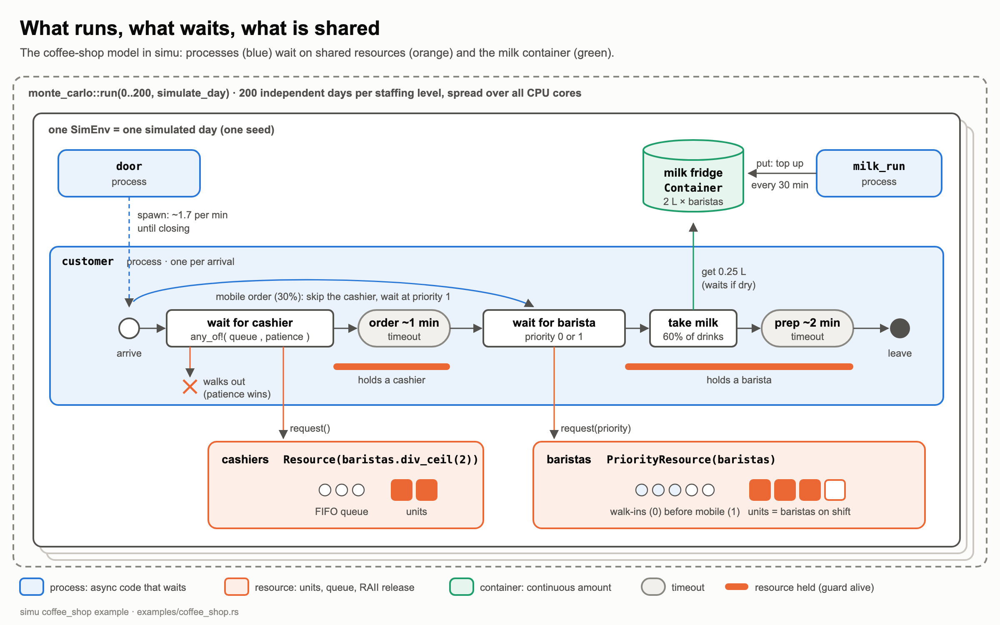
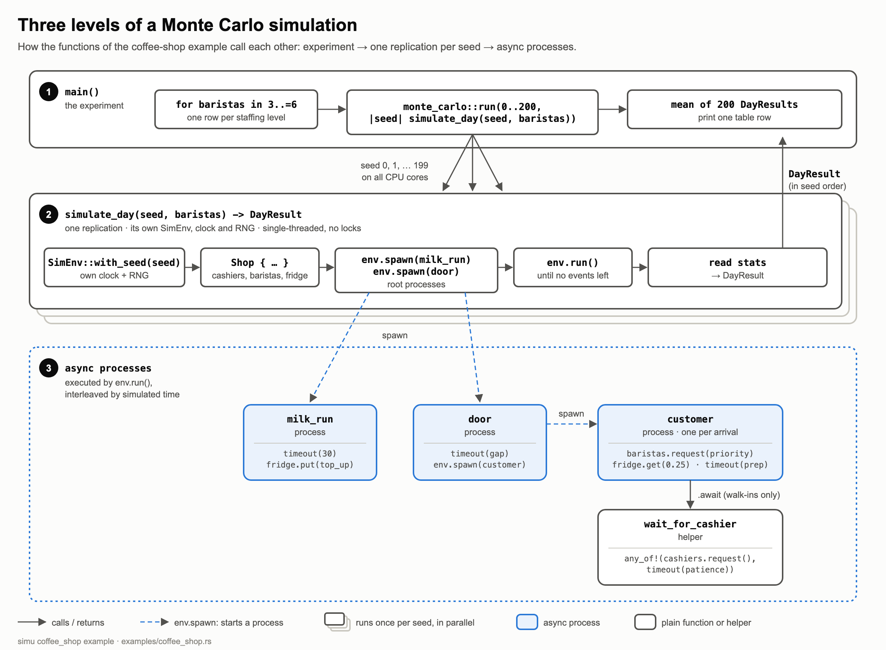

# Medium article: skeleton & fact sheet (not the article)

> **Status:** skeleton only. Every section lists *talking points, numbers, and
> snippets* for the author to write up. Nothing here is meant to be published as
> it stands. Numbers come from a fresh run on 2026-10-05 (see the appendix).

**Working title options**
- "SimPy's answers, 18× faster: discrete-event simulation in Rust with simu"
- "I rewrote SimPy's mental model in Rust. Same results, seed for seed, up to 40× faster."
- "Discrete-event simulation in Rust, without the Rust pain"

**Target reader:** SimPy users who hit runtime limits (many replications, big
models), and Rust developers who need simulation and don't want to embed Python.

**Length target:** ~1,800 words, 7–9 min read. Two charts, two or three code blocks, two tables.

**Running example: a coffee shop.** No healthcare or industrial examples. The
coffee shop works on three levels: the DES primer (§2), the showcase
(`examples/coffee_shop.rs`, §5), and the benchmark that scales from 1k to 1M
customers (§7). The EV charging station in §4 is the tutorial's own example;
swap it for a mini coffee shop if you prefer one domain throughout.

---

## 1. Hook

TODO: Remove bullet points after checking correctness and completeness
- Pain point: SimPy is the default for DES in Python, and it's pleasant to use.
  Slowness bites when you need many replications (confidence intervals,
  parameter sweeps, optimisation loops).
- Concrete hook numbers (coffee-shop benchmark, `compare/REPORT.md`):
  - **One run with 1 million customers: SimPy 12.5 s, simu 0.68 s.**
  - **1,000 runs of 2,000 customers each: SimPy 25.1 s, simu 0.59 s
    on 10 cores (42.8×).**
- Promise of the article: same modelling style, same random numbers, same
  answers, 12–18× faster on one core, up to ~43× with parallel runs. Plus: why
  Rust is no longer the hard part.
- *Author's choice:* a personal sentence on why you built it (a model that was
  too slow?). A personal origin story makes the article feel genuine.

When researchers and engineers need to create a simulation from scratch they often end up using the Python module [SimPy](https://simpy.readthedocs.io/). It combines the fast and simple turn-around time of Python with a fairly complete module that offers the basic infrastructure for [Discrete Event Simulation](https://en.wikipedia.org/wiki/Discrete-event_simulation). This is especially true during the exploratory phase in a [Jupyter Notebook](https://jupyter.org/).
In the modern world of fast turn-arounds these prototypes then often end up becoming the product. And when that product needs to run high performance simulations with large scenarios and huge data, the slowness of Python is hurting. Moreover, a notebook prototype that grows into a product tends to carry its prototype habits along: lengthy, complex functions doing many things are hard to test, hence test automation is de-prioritized, and the result is a quickly developed, but hard to maintain and slow application.

In my opinion, AI-supported coding will change the entire process: Researchers will simply request the AI to write the algorithm they want to try out, rather than writing and testing it themselves in a Jupyter Notebook. And in my experience, Rust is a great language for AI-based engineering, because the compiler gives detailed feedback, the language is structured, and there is a rich ecosystem of crates.

My Rust crate [simu-des](https://crates.io/crates/simu-des) offers just that: a framework offering the core features of Python's SimPy, written in Rust, that follows SimPy's concepts but in a Rust-idiomatic way. In addition, I put effort into providing [markdown files](https://github.com/chkhm/simu/blob/master/docs/simu-for-agents.md) which enable your favorite programming agent to create a simulation for you quickly and in great quality.

In this article, I will introduce you to the framework, highlight the similarity to SimPy, and provide you with some performance numbers that hopefully convince you to give it a try when you have to create your next simulator. I'll round out the article with examples of how you can use AI-supported programming for quick simulation development.


## 2. DES in 60 seconds (short primer)

TODO: Remove bullet points after checking correctness and completeness
- DES = model a system as **events at points in time**; the clock *jumps* from
  event to event (no fixed time step). Nothing happens between events.
- Building blocks (map each to a simu type later):
  - **Processes**: entities with behaviour (customer, barista, milk delivery) → `async` blocks
  - **Time passing**: "service takes 5 minutes" → `h.timeout(5.0).await`
  - **Resources**: capacity-limited, queue when busy → `Resource::new(2)`
  - **Randomness**: arrival/service times → seeded RNG, replications
- Picture idea: a coffee shop with 2 baristas, a queue, and a timeline of events.
  The ASCII flow diagram in `examples/coffee_shop.md` can be redrawn as the
  article's first figure.
- Why SimPy's style won: processes written as *straight-line code* (generators
  with `yield`) instead of hand-written event handlers.
- Bridge sentence idea: Rust's `async/await` is the same idea as SimPy's
  generators. A process suspends at `.await` the way it suspends at `yield`.

Before we dive into the nuts and bolts of simu-des, we need to understand what Discrete Event Simulation actually is: 
"A discrete event simulation (DES) is a modeling method that represents a system as a chronological sequence of distinct, instantaneous events where state changes occur." ([Royal HaskoningDHV](https://www.haskoning.com/en/newsroom/blogs/2024/what-is-discrete-event-simulation-and-how-does-it-work)) The interesting part of DES is that it does not continuously simulate the progress of time in uniform fractions of seconds. Instead it jumps in time from one event timestamp to the next. Quiet phases, during which nothing of importance (for this simulation) happens, are simply skipped. At each event time, you typically calculate the changes of the system, calculate the next event (or events), put them into an event priority queue, and hop on to the next event. This allows you to very rapidly simulate a system. Most interesting models are stochastic: event times are drawn at random (e.g., a coffee shop with randomly arriving customers). A single run then tells you little, so DES is often combined with Monte Carlo simulation: you run the same model many times with different random seeds and look at the distribution of the results. This allows you to analyze how well a system copes with random fluctuations.

For more details on Discrete Event Simulation have a look at the [Wikipedia article](https://en.wikipedia.org/wiki/Discrete-event_simulation), the [SimPy documentation](https://simpy.readthedocs.io/), or the classic textbook *Simulation Modeling and Analysis* by Averill M. Law, and watch out for my upcoming introductory article on this very useful technique.


## 3. Meet simu

TODO: Remove bullet points after checking correctness and completeness
- crates.io: **`simu-des`** (the library is imported as `simu`), v0.1.0, MIT OR Apache-2.0.
  `cargo add simu-des`
- Repo: https://github.com/chkhm/simu · Docs: https://docs.rs/simu-des (start at the `tutorial` module)
- Design points worth one sentence each:
  - Own **single-threaded async executor** driven by *simulated* time. No tokio,
    no async runtime dependency.
  - **Deterministic:** events ordered by (time, insertion order), so same seed ⇒ identical run.
  - Resources are cheap `Rc` handles you `clone()`. No `Arc<Mutex>` ceremony
    (the executor is single-threaded, so it doesn't need them).
  - **RAII release:** a resource unit is returned automatically when its guard
    goes out of scope. You can't forget to release it.
  - Parallelism lives *between* replications (`monte_carlo::run`), not inside one.

**`simu-des`** is my recently released Rust crate, v0.1.0, MIT or Apache-2.0 licensed. You can add it to your Rust project with `cargo add simu-des`. The source code can be found in my [GitHub repository](https://github.com/chkhm/simu), and the documentation is on [docs.rs](https://docs.rs/simu-des). I recommend that you start with the [`tutorial` module](https://docs.rs/simu-des/latest/simu/tutorial/index.html). Note that the package is called `simu-des` (the name `simu` was already taken on crates.io), but in your code you import it as `simu`.
Here are some design highlights:

- It runs in a **single-threaded async executor** that is driven by the *simulated* time. Although it uses async mechanisms it does not depend on tokio or any other async runtime.
- **Deterministic**: I took quite some care to ensure that repeated runs with the same input lead to the same result: events are ordered by time. Events with the same time stamp are processed by insertion order. If you run a simulation with the same seed multiple times, you will always get the same run and hence the same result. This also holds for Monte Carlo runs executed in parallel.
- Resources are cheap `Rc` handles which can be cloned with `clone()`. No need for atomic ref counters and mutexes with `Arc<Mutex>` because the executor is single-threaded.
- **RAII release:** following good Rust programming habits, a resource unit is returned automatically when its guard goes out of scope. So a unit can't stay occupied forever just because a release call was forgotten, which would leave every process queued behind it waiting forever.
- **Fast per run:** the simulation is compiled code without an interpreter in between. On a single core, simu runs the same models 12–18× faster than SimPy (see section 7).
- **Parallel across runs:** on top of that, a Monte Carlo simulation makes use of the multi-core capabilities of your hardware by running the simulation with different seeds in parallel (`monte_carlo::run`). Within one run, execution stays sequential.

We will look at these mechanisms in the following sections. But first, let's start with a simple "Hello World" simulator.

## 4. Your first model: SimPy vs simu side by side

TODO: Remove bullet points after checking correctness and completeness
- Model: 4 electric cars, staggered arrivals, a charging station with 2 spots.
  This is the classic SimPy tutorial scenario. Both programs print **identical
  traces** (verified; output below).
- Rust (verbatim from `examples/intro_charging_station.rs`, tutorial chapter 4):


In this section we look at a simple simulation of a car charging station. For those familiar with SimPy, this example will look familiar. In this example we simulate a system consisting of 4 electric cars with staggered arrival times at a charging point with two charging spots. They spend a certain time at the charging point for recharging, and then drive off, making room for the next car to use it. The example is also discussed in [chapter 4 of the simu tutorial](https://docs.rs/simu-des/latest/simu/tutorial/ch04_shared_resources/index.html). The following code is a verbatim copy of the tutorial's runnable example [`examples/intro_charging_station.rs`](https://github.com/chkhm/simu/blob/master/examples/intro_charging_station.rs):

```rust
use simu::{Resource, SimEnv};

fn main() {
    let mut env = SimEnv::with_seed(42);
    let bcs = Resource::new(2); // battery charging station, 2 spots

    for i in 0..4u32 {
        let h = env.handle();
        let station = bcs.clone(); // same pool, cheap Rc clone
        env.spawn(async move {
            h.timeout(f64::from(i) * 2.0).await; // drive to the station
            println!("Car {i} arriving at {}", h.now());

            let _spot = station.request().await; // queue for a spot (FIFO)
            println!("Car {i} starting to charge at {}", h.now());

            h.timeout(5.0).await; // charge
            println!("Car {i} leaving at {}", h.now());
        }); // _spot drops here → spot handed to the next car in line
    }

    env.run();
    println!("Simulation ended at {}", env.now());
}
```

We start by creating the simulation environment object `env`. This provides the control functionality for the simulation. Next, we create a single resource with two charging spots. In the for-loop we register asynchronous processes; one for each car, so 4 in total.
Each of the four processes works with a handle of the simulation environment as well as with a clone of the battery charging point resource. This clone points to the same two charging points, so despite the clone we still have access to the same data. The timeout function call ensures that the car arrival at the charging point is staggered with a 2 time units time interval. The `station.request()` tries to acquire one of the two charging spots. If both spots are occupied, the process is queued up and waits. The charging time is hard-coded with 5 time units. After this, the process is completed, the variable `_spot` goes out of scope and the resource is released.

Note that the for-loop is setting the simulation up, by adding each process to the environment with `env.spawn`. Execution is only started when `env.run()` is called.

Now let's take a look at the Python counterpart. It is written specifically for this article, and is tested with SimPy 4.1.2:

```python
import simpy

def car(env, i, station):
    yield env.timeout(i * 2.0)                      # drive to the station
    print(f"Car {i} arriving at {env.now}")
    with station.request() as spot:                 # queue for a spot (FIFO)
        yield spot
        print(f"Car {i} starting to charge at {env.now}")
        yield env.timeout(5.0)                      # charge
        print(f"Car {i} leaving at {env.now}")      # spot released on exit

env = simpy.Environment()
bcs = simpy.Resource(env, capacity=2)               # 2 charging spots
for i in range(4):
    env.process(car(env, i, bcs))
env.run()
print(f"Simulation ended at {env.now}")
```

Note that the code works very similarly to the simu Rust code. We also have a simulation environment, resources, and processes. Some of the Rust ownership plumbing is obviously not needed in Python, but otherwise the code is very similar. The Rust code and the Python code create the same output with a minute difference in floating number formatting: Python prints `5.0` where Rust prints `5`. Here is the Rust output:

```
Car 0 arriving at 0
Car 0 starting to charge at 0
Car 1 arriving at 2
Car 1 starting to charge at 2
Car 2 arriving at 4
Car 0 leaving at 5
Car 2 starting to charge at 5
Car 3 arriving at 6
Car 1 leaving at 7
Car 3 starting to charge at 7
Car 2 leaving at 10
Car 3 leaving at 12
Simulation ended at 12
```

The following table summarizes the mapping between the SimPy original and the Rust re-implementation:

| SimPy | simu |
|---|---|
| `env.process(gen)` | `env.spawn(async move { … })` |
| `yield env.timeout(5)` | `h.timeout(5.0).await` |
| `with res.request() as r: yield r` | `let _g = res.request().await;` (released on drop) |
| `simpy.Resource(env, capacity=2)` | `Resource::new(2)`, shared via `.clone()` |
| `env.run(until=15)` | `env.run_until(15.0)` |

The reader will of course notice that the Rust version is a bit longer because Rust requires some explicit ownership plumbing in the form of boilerplate code (`handle()`, `clone()`, and `async move`). However, this is the stuff that an AI agent easily writes for you. You'll find more about that in section 8.

## 5. What's in the box

In this section we take a quick walk through the features included so far:

### 5.1 Resources

- Resources: `Resource` (FIFO), `PriorityResource` (lower number = higher
  priority, FIFO within a level), `PreemptiveResource` (higher priority evicts
  a running holder; cooperative: the holder notices via `guard.preempted()`),
  `Container` (continuous quantity, e.g. a fuel tank, strict FIFO).

A resource is a system element with a limited capacity that simulation processes must request, utilize, and release to perform tasks. It represents any physical or abstract entity that constrains the flow of work because it cannot handle an infinite amount of demand simultaneously.

Here are the most important characteristics of a resource:

- Capacity Limits: A resource has a defined limit on how many processes it can serve at one time.
- Request and Release Lifecycle: Processes follow a strict cycle: they Request the resource, Hold it for a duration of virtual simulation time, and Release it when finished.
- Queue Management: If a process requests a resource that is fully occupied, the simulation automatically places that process into a waiting queue (line) until capacity frees up. 

The module currently supports four types of resources:

1. `Resource` represents scarce elements that need to be allocated before they can be used. A `Resource` has a capacity of *n* units; each unit is held by one process at a time. When all units are busy, further requests wait in a FIFO queue based on arrival time.
2. `PriorityResource` adds the feature that processes provide a priority value when trying to acquire the resource. Waiting processes are sorted first by their priority number (lower number = served first), and second by arrival time.
3. `PreemptiveResource` lets a higher-priority request take a unit away from a lower-priority holder immediately. Preemption is cooperative: the holder notices it at its next wait point by racing its work against `guard.preempted()` (e.g. `any_of![h.timeout(d), guard.preempted()]`), or by checking `guard.is_preempted()` afterwards. The preempted process does not go back into the queue automatically; it decides itself whether to request the resource again.
4. `Container` is a continuous resource; i.e. it can represent non-discrete resources like tanks filled with liquids. Containers operate in a strict FIFO mode: the first waiting process gets its amount as soon as enough is available, and later requests wait behind it. Needless to say, these resources can be "refilled" with `put`.

Based on the example shown above, you can see that using resources is a simple and easy to understand mechanism.

### 5.2 Signalling

TODO: Remove bullet points after checking correctness and completeness
- Signalling: `env.event()` gives `(EventTrigger, EventAwaitable)`. Many waiters,
  fire once. If the event fires before anyone awaits it, later waiters still see it.
- Combinators: `any_of!` / `all_of!` (race a timeout against a signal; the losing
  branch is dropped, which is simu's equivalent of SimPy's `Interrupt`).

Processes need to be able to communicate with each other. This is done by signalling events. We haven't seen the signalling mechanism in use yet, so here is a short example:

```rust
use simu::SimEnv;

fn main() {
    // 1. Initialize the simulation environment
    let mut env = SimEnv::new();

    // 2. Create the event pair via env.event() -> (EventTrigger, EventAwaitable)
    let (trigger, ready) = env.event();

    // 3. Spawn customer processes using env.handle()
    for customer_id in 1..=3 {
        let env_handle = env.handle();
        let r = ready.clone();
        env.spawn(async move {
            env_handle.timeout(f64::from(customer_id) * 2.0).await; // arrival time of customer
            println!(
                "[Time: {:.1}] Customer {} arrives and waits outside.",
                env_handle.now(),
                customer_id
            );
            // Wait for the EventTrigger to fire
            r.await;
            println!(
                "[Time: {:.1}] Customer {} goes inside to get help!",
                env_handle.now(),
                customer_id
            );
        });
    }

    // 4. Spawn a staff process using env.handle() to trigger the event
    let env_handle = env.handle();
    env.spawn(async move {
        // Wait 5.5 units of virtual simulation time
        env_handle.timeout(5.5).await;

        println!(
            "[Time: {:.1}] Technician arrives and opens the doors!",
            env_handle.now()
        );

        // Call fire() on the EventTrigger to resume all listeners
        trigger.fire();
    });

    // 5. Run the discrete event simulation loop
    env.run();
}
```

This artificial example simulates a situation where customers arrive at a tech-support desk which is closed until timestamp `5.5`. Before that, customers show up at the door of the tech support, and since it is closed, they are awaiting the event that the tech support staff arrives and helps them. Here it is assumed that they can all be helped at once (unrealistic), but it shows that an event, when fired, releases all waiting processes.

Note that customer 3 arrives after the tech-support staff arrived, so they are immediately released and can go inside right away. This shows that once an event is fired, the door stays open. The mechanism is deliberately designed as a broadcast communication mechanism. If you want to release individual processes, you usually have a situation with a limited resource, and you should have the processes wait on a resource accordingly.

The simu crate offers more mechanisms to realize different scenarios. For example the macros `any_of!` and `all_of!` allow a process to wait for the first of, or for all of, several futures: timeouts, events, or child processes (anything that returns nothing). `any_of!` is particularly useful when you want to wait for an event with a timeout: `any_of![env_handle.timeout(10.0), signal.clone()].await;`. Note that `any_of!` does not tell you *which* future won; you find out afterwards, e.g. by checking `env_handle.now()` or a flag set by the winning branch. `all_of!` is obviously useful in situations where multiple events must have happened before a process can be released: `all_of![trainer_arrived_event.clone(), football_arrived_event.clone()].await;`.


### 5.3 Waiting for child processes

TODO: Remove bullet points after checking correctness and completeness
- `ProcessHandle<T>`: spawn a child, `.await` its return value (like a typed join).

When you `spawn` a process, you get back a `ProcessHandle<T>`, where `T` is whatever the process's `async` block returns. Awaiting the handle suspends the parent until the child has finished, and then hands over the child's return value. If you know Rust's threads, this is the equivalent of `std::thread::JoinHandle::join()`; in SimPy it corresponds to `value = yield env.process(child())`. You wait for a sub-task and get its result, and the compiler checks the type of that result.

[Chapter 2 of the tutorial](https://docs.rs/simu-des/latest/simu/tutorial/ch02_waiting_for_processes/index.html) (runnable as [`examples/intro_charging.rs`](https://github.com/chkhm/simu/blob/master/examples/intro_charging.rs)) shows this. A driving process spawns a charging sub-process and waits for it:

```rust
let hc = h.clone();
let charging = h.spawn(async move {
    hc.timeout(5.0).await;
    42.0 // a process can return a value, e.g. the kWh charged
});
let kwh = charging.await; // suspend until charging finishes
```

A few things are worth knowing about process handles:

- **Fork-join:** a parent can spawn several children and wait for all of them with `all_of![child_a, child_b].await` (this works for children that return nothing). The [warehouse example](https://github.com/chkhm/simu/blob/master/examples/warehouse.rs) uses this to find out when the whole day's work is done.
- **Drop to detach:** if you don't keep the handle, the child simply keeps running on its own (fire-and-forget), just like the cars in the charging-station example.
- **One waiter only:** a handle cannot be cloned, so exactly one process can await the result. If several processes need to know that something finished, fire an event at the end of the child; that's the broadcast mechanism from section 5.2.

In short: events are for *"tell everyone"*, a process handle is for *"wait for my sub-task and get its answer"*, and resources and containers are for *"admit one at a time"*.

### 5.4 Randomness and Monte Carlo Simulations

TODO: Remove bullet points after checking correctness and completeness
- Pluggable randomness: default seeded `StdRng`, or `SplitMix64` for cross-engine comparisons.
- `monte_carlo::run`: replications over threads (`std::thread`, or rayon via
  the `monte-carlo` feature). Results come back in seed order, identical to a sequential run.

A key functionality of a simulator is to run it repeatedly with differing random number seeds to calculate averages, or to find corner cases. This is also called [Monte Carlo simulation](https://en.wikipedia.org/wiki/Monte_Carlo_method). `simu` offers you two ways to plug in randomness: (1) `StdRng`, the default random number generator of Rust's widely used [`rand`](https://crates.io/crates/rand) crate (used by `SimEnv::with_seed(seed)`), and (2) [`SplitMix64`](https://prng.di.unimi.it/), a simple random number generator algorithm that is easy to re-implement in other programming languages (plugged in with `SimEnv::with_source(SplitMix64::new(seed))`). `StdRng` is the natural default in Rust: well tested, reliable, and fast. The crate also offers `SplitMix64` so that simulations written with simu can be compared to simulations written in other programming languages. It is also useful if a simulation written in Rust must cooperate with a program written in a different programming language and they both need to rely on the same sequence of random numbers. My main reason here was so that I can compare the performance of Rust-based simulations against those written in Python.

The following short example shows how Monte-Carlo simulations can be done with `simu`: Imagine you have a coffee shop with a single barista, customers arriving on average every 2.5 minutes, and an average coffee preparation time of 2 minutes. We want to know the expected average waiting time per customer. The following short program simulates 1 hour with 1,000 different random number seeds:

```bash
cargo new one_barista_monte-carlo
cd one_barista_monte-carlo
cargo add simu-des --features monte-carlo
cargo add rand@0.9 rand_distr@0.5
```

Copy the following code into the `src/main.rs` file and run it with `cargo run --release`:

```rust
// main.rs
use std::cell::RefCell;
use std::rc::Rc;

use rand::Rng;
use rand_distr::Exp;
use simu::{monte_carlo, Resource, SimEnv};

/// One hour at a coffee stand with one barista. Returns the mean wait (minutes).
fn one_hour(seed: u64) -> f64 {
    let mut env = SimEnv::with_seed(seed);
    let barista = Resource::new(1);
    let waits = Rc::new(RefCell::new(Vec::new()));

    let h = env.handle();
    let w = waits.clone();
    env.spawn(async move {
        while h.now() < 60.0 {
            let gap = h.rng().sample(Exp::new(1.0 / 2.5).unwrap()); // a customer every 2.5 min
            h.timeout(gap).await;
            let (hc, b, w) = (h.clone(), barista.clone(), w.clone());
            h.spawn(async move {
                let arrived = hc.now();
                let _barista = b.request().await;
                w.borrow_mut().push(hc.now() - arrived);
                let prep = hc.rng().sample(Exp::new(1.0 / 2.0).unwrap()); // ~2 min per drink
                hc.timeout(prep).await;
            });
        }
    });
    env.run();

    let waits = waits.borrow();
    waits.iter().sum::<f64>() / waits.len().max(1) as f64
}

fn main() {
    // 1,000 independent hours, one seed each, spread over all CPU cores
    let mut results = monte_carlo::run(0..1000, one_hour);

    results.sort_by(f64::total_cmp);
    let mean = results.iter().sum::<f64>() / results.len() as f64;
    println!("average wait:   {mean:.1} min");
    println!("best 5% of hours: under {:.1} min", results[50]);
    println!("worst 5% of hours: over {:.1} min", results[950]);
}
```

The output is the same on every run, because each seed fully determines its simulated hour:

```
average wait:   3.9 min
best 5% of hours: under 0.6 min
worst 5% of hours: over 11.0 min
```

As you can see, the function `one_hour()` simulates one hour of operation of the coffee shop. It spawns an arrival process that loops until the simulation time reaches 60 time units. Within that loop we wait for a random time (on average 2.5 time units). Afterwards we spawn another process: the customer process. Within that process we wait for the barista resource to become available and store the customer's waiting time (the time from arrival until the barista became available) in the vector `waits`. Then we simulate the coffee preparation time, again by waiting for a random time of 2 time units on average. After 60 minutes no new customers arrive, but `env.run()` continues until the last waiting customer has been served. Then the `one_hour` function calculates the average waiting time of the customers stored in the vector `waits`.

The trick is that each customer process runs as its own process, so the arrival process that spawns it does not have to wait for it to complete. Hence, new customers can arrive before the previous customers have been served. The queuing of those customer processes happens at the barista resource.

`monte_carlo::run()` calls `one_hour` once per seed, spread over all CPU cores, and returns the results in seed order. The `main` function then sorts them and calculates the overall average as well as the best and worst 5%.

This concludes the rapid walk through of the features, and the barista example outlined above is a great cue to introduce the example I will use to showcase the performance of this framework:

### 5.5 The Coffee Shop example

TODO: remove when done
- Showcase examples to mention: **`coffee_shop`** (the article's running example,
  see below) and `warehouse` (logistics: a forklift fleet shared between
  receiving and shipping, the `PreemptiveResource` showcase). Each has a `.md`
  walkthrough. (Leave the other repo examples out of the article.)
- **Coffee-shop showcase** (`cargo run --release --example coffee_shop`): a
  staffing study with 200 simulated days per setting, run in parallel. Real
  output (deterministic seeds 0–199; takes <1 s for all 800 days):

TODO: remove when done
  - Story: going from 3 to 4 baristas cuts time in shop from 59 to 5 minutes
    (queues explode near 100% utilisation). The 6th barista buys almost nothing.
    Walk-outs depend on the cashiers, not the baristas.
  - Primitives used: `Resource` (cashiers), `any_of!` (patience vs queue),
    `PriorityResource` (walk-ins before mobile orders), `Container` (milk
    fridge), `monte_carlo::run`.
- Optional cancellation snippet (verbatim, `examples/intro_cancellation.rs`, the core of it):

```rust
any_of![h.timeout(5.0), stop_signal].await;
```

Imagine you want to simulate a coffee shop to find out how the number of baristas impacts the waiting time of the customers. A coffee shop has baristas, cashiers as discrete resources, and milk as a continuous resource. Obviously, customers have only a limited amount of patience, and if they have to wait too long they will simply leave your shop and get their coffee somewhere else, despite you serving the best coffee in the world. Since this is a 21st-century coffee shop, it also supports mobile ordering. Mobile orders skip the cashier, but the baristas serve the walk-in customers standing at the counter first, i.e. mobile orders are handled with lower priority.

The complete source code is part of the project repository: [`examples/coffee_shop.rs`](https://github.com/chkhm/simu/blob/master/examples/coffee_shop.rs), with a walkthrough in [`examples/coffee_shop.md`](https://github.com/chkhm/simu/blob/master/examples/coffee_shop.md).

The easiest way to try it out is to clone the git repository and run:

```bash
git clone https://github.com/chkhm/simu.git
cd simu
cargo run --release --example coffee_shop
```

A run gives you the following result (the seeds are fixed, so you should see exactly these numbers):

```
Baristas  Cashiers    Served  Walk-outs    Time in shop  Barista use
------------------------------------------------------------------
       3         2       779       34.2        59.0 min          99%
       4         2       779       34.2         5.2 min          83%
       5         3       806        7.1         3.1 min          67%
       6         3       806        7.1         2.9 min          56%
```

Before we discuss the technical implementation, the results teach us that there is a sweet spot of 5 baristas combined with 3 cashiers. With only 3 baristas, the baristas are busy 99% of the time and customers spend about an hour in the shop. The step from 4 to 5 baristas mainly helps because it brings a third cashier, which cuts the walk-outs from 34 to 7. Increasing the baristas from 5 to 6 does not significantly reduce the waiting time of the customers. Obviously, more economic aspects could be considered, but I leave it to you to come up with more complex questions and more complex simulation scenarios for this coffee shop (seasonality, availability of baristas, ordering frequency for milk, coffee as a continuous resource, etc.).

Instead, let us dive a bit deeper into how this simpler scenario is currently modeled. The following figure describes how resources, containers, processes, and Monte Carlo runs are used to simulate the coffee shop:



As you can see, the example has a `door` process that spawns about 1.7 customer processes per time unit (minute), i.e. one every ~0.6 minutes on average. About 30% of these customers are mobile orders. A mobile customer process skips the cashier and queues up at the `PriorityResource` baristas with priority 1, i.e. behind the walk-ins. A walk-in customer process first queues up at the `Resource` cashiers. It waits with an `any_of!` until it either acquires a cashier or its patience runs out; in the latter case the customer walks out. It holds the cashier for ~1 time unit while ordering. After that it queues up at the `PriorityResource` baristas with priority 0, i.e. ahead of the mobile orders. For milk drinks, the process then takes milk from the `Container` milk fridge. If the fridge is empty, the process waits for the refill by a separate process, `milk_run`, which tops up the fridge every 30 time units. Finally, the process simulates the coffee preparation for 2 minutes on average. Once completed, the process terminates and releases the barista.

The following figure shows how this concept is realized by the functions you find in the source code:



The `main` function is responsible for triggering the Monte Carlo simulations with different staffing settings. This is done in the for loop, which starts the first Monte Carlo simulation with 3 baristas and goes all the way to 6 baristas. For each configuration it calls `monte_carlo::run()`, simulating 200 days, each with a different random number seed. It then calculates the statistics of each Monte Carlo simulation and prints them out.

`simulate_day` is the function called for each Monte Carlo run: it creates a new simulation environment with the given seed, instantiates a `Shop` object holding the resources and statistics of the coffee shop, and spawns the `milk_run` process as well as the `door` process. It kicks the simulation off with a call to `env.run()`, which returns when no events are left, and then creates the statistics to be returned.

`milk_run` is trivial: it waits for 30 time units and then tops up the milk fridge (`Container`). It stops once the shop has closed and the last customer has left.

`door` is also straightforward: it spawns the customer processes with the given arrival rate until the shop closes after 480 time units (one 8-hour working day). Customers already inside are still served after closing.

`customer` implements the customer process outlined above: it first draws all required random values: order type (mobile vs. walk-in), order time, patience, preparation time, and whether the drink needs milk. If it is a walk-in the process calls `wait_for_cashier`. This helper function returns either a cashier if one became available before the patience timer expired, or `None` otherwise. This is done with the `any_of!` macro. If the function gives back `None` we abort the customer process right away. Otherwise the process waits for the order time, releases the cashier (its guard goes out of scope), and then lines up for a barista (`PriorityResource`): walk-ins with priority 0, mobile customers with priority 1. The rest is as expected: we take milk from the fridge (`Container`) if the drink needs milk. This might cause extra waiting if the milk has run out. We then wait for the preparation time. When the process ends, the barista is released. The release of the barista as well as of the cashier both happen implicitly when the corresponding guard variables go out of scope.

This concludes the discussion of the coffee shop example. Take a look at the markdown file with more details in the github repository (TODO: add link).

Next, let's take a look how we can compare this implementation against a simulator that uses Python and SimPy.

## 6. Same answers as SimPy, and how that's proven

TODO: Remove after making sure everything is covered
- Problem: "is it correct?" is the first question for any new simulator.
- Method: a comparison harness (`compare/`) runs the *same model* in both engines.
  The SplitMix64 random generator and the distribution transforms are
  re-implemented byte-for-byte in Python, so **both engines draw identical random numbers**.
- Result (200 seeds × 1,000 customers per model): M/M/1, M/M/2, priority queue,
  container, **and the coffee shop** agree **seed-by-seed** with a max
  per-seed difference of **~3e-15** (floating-point summation order).
  Statistically: t-test p = 1.000, KS p = 1.000.
- The coffee shop is the strongest proof point: reneging, priorities, and milk
  stockouts all interact, and every count still matches exactly (served 957.7,
  reneged 42.34 on average, 0 difference on every seed).

In order to be able to compare an implementation in Python against an implementation in Rust with simu-des we need to make sure that they are doing the same thing. First of all, they both need to return the same output. For this to happen they need to use the same random number generator algorithm so that they use the same sequence of random numbers. Moreover, for a benchmark we need more flexibility: Instead of hard-coded parameters, we use a command line parser to get simulation parameters. And then of course, we need to make some small modifications to switch from Rust's built-in random number generator to a the aforementioned SplitMix64. The code for the updated coffee shop example is in github (TODO provide the link).

The following figure shows the modifications in the code design.


As you can see the functions are still the same structure but slightly renamed. Whereever there are changes to the original you see a small $delta$ triangle. The conceptual difference: we now do not run multiple different coffee shop configurations with differing numbers of baristas from the main function. We also do not terminate the simulation when a certain amount of simulated time is passed. Instead we are simulating the arrival and processing of a certain number of customers. This makes it easier to scale the benchmark runs.

`run_coffee` is the function that simulates the coffee shop for one run (i.e. one seed). It kicks off the customer arrival process `arrival` as well as the milk refill process `restock`.

`arrival` is the process that loops until all `n` customer arrivals have been simulated. Each customer is spawned as a process with a randomized timeout interval.

`customer` finally does the same thing as the original coffee shop function (cashier, preparation, milk consumption, loosing patience). 

The code also holds some additional variables for performance measurement.


| model | metric | simu | SimPy | max per-seed Δ |
|---|---|---|---|---|
| M/M/1 (λ=0.85, μ=1) | mean wait | 5.237 | 5.237 | 2.9e-15 |
| M/M/2 (λ=1.6, μ=1) | mean wait | 1.685 | 1.685 | 2.3e-15 |
| priority (2 classes) | mean wait, high / low | 1.454 / 9.33 | 1.454 / 9.33 | ≤1.7e-15 |
| container | served | 942.4 | 942.4 | 0 |
| coffee shop (4 baristas) | mean time in shop | 5.332 min | 5.332 min | 2.8e-15 |
| coffee shop | walk-outs per 1,000 customers | 42.34 | 42.34 | 0 |

- Independent sanity check: queue models are also compared against queueing
  theory (Erlang C). Analytic M/M/1 mean wait is 5.667 vs. 5.237 simulated. The
  gap is the expected bias of short runs that start empty (1,000 customers, no
  warm-up). Explain in one sentence or skip; don't let it look like an error.
- Honesty point (optional, builds trust): exact agreement needs models where
  no two events land on the *same* timestamp in an order-sensitive way. When
  they do (e.g. one process evicting another at the same instant), the two
  engines may tie-break differently. Both orders are valid, so results then
  agree only statistically. The repo documents one such case in
  `compare/README.md`; no need to name it in the article.

## 7. The numbers

- Charts (SVG sources next to them):
  - `articles/simu-vs-simpy-speedup.png`: speedup bars, single-thread and parallel.
  - `articles/coffee-scaling.png`: coffee shop, wall time vs. customers (log-log),
    two parallel lines 18× apart. This is probably the hero image.
- Single-thread (one big replication, 100,000 customers = 200,000 events):

| model | simu | SimPy | speedup | peak memory (simu / SimPy) |
|---|---|---|---|---|
| M/M/1 | 0.039 s · 5.1 M events/s | 0.488 s · 0.41 M events/s | **12.5×** | 9 MB / 48 MB |
| M/M/2 | 0.038 s · 5.2 M events/s | 0.500 s · 0.40 M events/s | **13.0×** | 9 MB / 48 MB |
| priority | 0.041 s · 4.8 M events/s | 0.598 s · 0.33 M events/s | **14.4×** | 9 MB / 41 MB |
| coffee shop | 0.069 s · 2.9 M events/s | 1.234 s · 0.16 M events/s | **17.9×** | 12 MB / 59 MB |

- Talking point: the richer the model, the bigger the gap (12.5× for a bare
  queue, 17.9× for the coffee shop). Plausible explanation, not profiled: each
  extra SimPy operation (condition events for reneging, container get/put)
  costs interpreter time, while simu's extra work is compiled code. Phrase it
  as an observation, not a proven cause.
- Scaling (coffee shop, 4 baristas, one run each):

| customers | simu | SimPy | speedup | peak memory (simu / SimPy) |
|---|---|---|---|---|
| 1,000 | 0.7 ms | 13 ms | 17.3× | 2 MB / 32 MB |
| 10,000 | 7 ms | 122 ms | 17.5× | 3 MB / 34 MB |
| 100,000 | 68 ms | 1.25 s | 18.3× | 12 MB / 59 MB |
| 1,000,000 | 0.68 s | 12.5 s | **18.5×** | 100 MB / 334 MB |

  - Both scale linearly (constant ~2.9 M vs ~0.16 M events/s). The speedup does
    not shrink with model size. Memory: 3.3× less at 1M customers.
- Parallel replications (simu `monte_carlo::run` on 10 cores vs SimPy sequential;
  Python's GIL prevents SimPy from using threads):

| workload | simu 1 core | simu 10 cores | SimPy | simu ‖ vs SimPy |
|---|---|---|---|---|
| coffee shop, 1,000 runs × 2,000 customers | 1.52 s | 0.59 s | 25.1 s | **42.8×** |
| M/M/1, 300 runs × 4,000 customers | 0.53 s | 0.25 s | 6.3 s | **25.9×** |

- Caveats to state (credibility):
  - Parallel scaling is only ~2.2–2.6× on this 10-core M4 (4 performance + 6
    efficiency cores; per-run allocation and memory bandwidth also limit it).
    Don't claim "10× from 10 cores".
  - SimPy could be parallelised with `multiprocessing`. That's fair to mention,
    but it costs process start-up and pickling, and the single-thread 12–14×
    gap remains.
  - All numbers come from one machine. Link the harness so readers can rerun it.
- Possible framing: "What takes a coffee break in SimPy finishes before you
  switch windows." Use your own words.

## 8. "But Rust is hard." Agentic coding changes the equation

Talking points, ordered from strongest to weakest:
- The traditional cost of Rust is *writing* it (lifetimes, ownership, clone/move
  dance). Coding agents now absorb most of that cost. What remains for the human
  is *reading* the model logic, which looks almost identical to SimPy (§4 table).
- The compiler acts as a **reviewer for agent-written code**. What it actually
  enforces here (verified facts only):
  - A `SimEnv` can't be accidentally shared across threads (`!Send`). Parallelism
    only happens the sanctioned way: one env per replication.
  - Ownership forces you to say explicitly which processes share a resource (`clone()`).
  - Resources are released by scope (RAII). No forgotten `release()` calls.
  - Type-checked return values from child processes (`ProcessHandle<T>`).
- **Do NOT claim** the compiler stops you holding `h.rng()` across an `.await`.
  It compiles fine and only panics at runtime if another process draws randomness
  meanwhile (verified 2026-10-05). The agent docs warn about it, so it can serve
  as an example of "docs for agents cover what the compiler can't".
- What simu ships for agents (this is the differentiator):
  - `llms.txt` (343 lines): single-file LLM reference, including a pitfalls table.
  - `docs/simu-for-agents.md` (92 lines): a drop-in context file for CLAUDE.md /
    Cursor rules / etc. ("Drop this file into your project's agent context…").
  - Rule in the repo: **every code pattern in those files is a verbatim copy of a
    doc-test**, so the agent's examples are guaranteed to compile and stay current.
  - Tutorial module on docs.rs (5 chapters) plus runnable `examples/intro_*.rs` twins.
- Suggested demonstration: a short real prompt you gave an agent ("model a
  bakery with 3 ovens…") and how many iterations it took to compile and run.
  *Only include if you actually do it.* An authentic anecdote beats a claim.
- Meta point (optional, if you're comfortable with it): simu itself was built
  with agentic coding: 52 commits since 2026-04-04, with a SimPy parity harness
  as the safety net. Decide how much to disclose.

## 9. When to stay with SimPy

- Exploratory modelling in Jupyter, teaching, quick one-offs: SimPy wins on iteration speed.
- An existing large SimPy codebase that's fast enough.
- Features simu doesn't have yet: `Interrupt` (simu uses `any_of!` racing
  instead), `Store` / `FilterStore`, real-time environment. These are on the roadmap (SPEC §6).
- Ergonomics gap, seen while building the coffee shop: SimPy's
  `yield req | env.timeout(patience)` is one line. In simu, `any_of!` returns `()`,
  so "request with a timeout" needs a small helper that parks the guard in an
  `Rc<RefCell<Option<_>>>` (`wait_for_cashier` in `examples/coffee_shop.rs`, 13
  lines). Worth admitting, and a candidate for a future API addition.
- A process panic currently aborts the whole run (no per-process isolation yet).
- Ecosystem: Python's plotting and stats stack. Possible mitigation: export
  results from Rust as CSV/JSON.

## 10. Get started / call to action

- `cargo add simu-des`, then `cargo run --example intro_charging_station`, then
  `cargo run --release --example coffee_shop`.
- docs.rs tutorial: https://docs.rs/simu-des, the "simu in 10 minutes" module
- GitHub: https://github.com/chkhm/simu (stars, issues, contributions;
  CONTRIBUTING.md, DCO sign-off)
- For agent users: copy `docs/simu-for-agents.md` into your agent context.
- Ask: "Tell me what model you'd port first", or which missing feature matters most.

---

## Appendix A: Measurement setup (for a footnote)

- Machine: Apple M4, 10 cores (4P + 6E), 16 GB RAM, macOS 26.7.1
- Rust: rustc 1.96.0-nightly (2026-02-28), `--release`, feature `monte-carlo` (rayon)
- Python: CPython 3.14.8, SimPy 4.1.2, numpy 2.5.0, scipy 1.18.0
- Python deps (fresh venv): numpy 2.5.3, scipy 1.18.1
- Date: 2026-10-05. Full report: `compare/REPORT.md` (regenerated on this date).
- Single-thread runs are sequential in one process for both tools. Wall time is
  the simulation time each tool reports itself, so it **excludes** interpreter
  and binary start-up. Memory = peak RSS of the whole process, so it includes
  the Python interpreter (~30 MB baseline).

## Appendix B: How to reproduce

```bash
compare/run_comparison.sh
```

This builds the Rust runner, creates `compare/.venv`, and writes
`compare/REPORT.md`: the correctness tables, single-thread table, coffee scaling
table, and Monte Carlo table. Every number in §6–§7 comes from that report
(full run takes ~2 minutes, mostly SimPy). A single coffee run by hand:

```bash
cargo build --release --features monte-carlo --example compare
target/release/examples/compare --model coffee --seeds 1 --n 1000000 --lambda 1.7 --mu 0.5 --servers 4
(cd compare/models && ../.venv/bin/python coffee.py --seeds 1 --n 1000000 --lambda 1.7 --mu 0.5 --servers 4)
```

## Appendix C: Pre-publication checklist

- [ ] Siemens holds the copyright. Check whether publishing needs approval or a disclosure line.
- [ ] Code blocks still match `examples/intro_charging_station.rs` / `examples/coffee_shop.rs`.
- [ ] Links resolve (crates.io, docs.rs, GitHub).
- [ ] Chart PNGs uploaded with alt text, e.g. "Bar chart: simu is 12.5–17.9× faster
      than SimPy single-threaded and 26–43× with parallel replications" and
      "Log-log line chart: coffee-shop run time grows linearly in both engines;
      at 1 million customers SimPy takes 12.5 s and simu 0.68 s".
- [ ] Medium tags (max 5): Rust, Simulation, Python, Programming, AI / Software Engineering.
- [ ] Optional: cross-post to r/rust, users.rust-lang.org, This Week in Rust (CFP/articles section).
